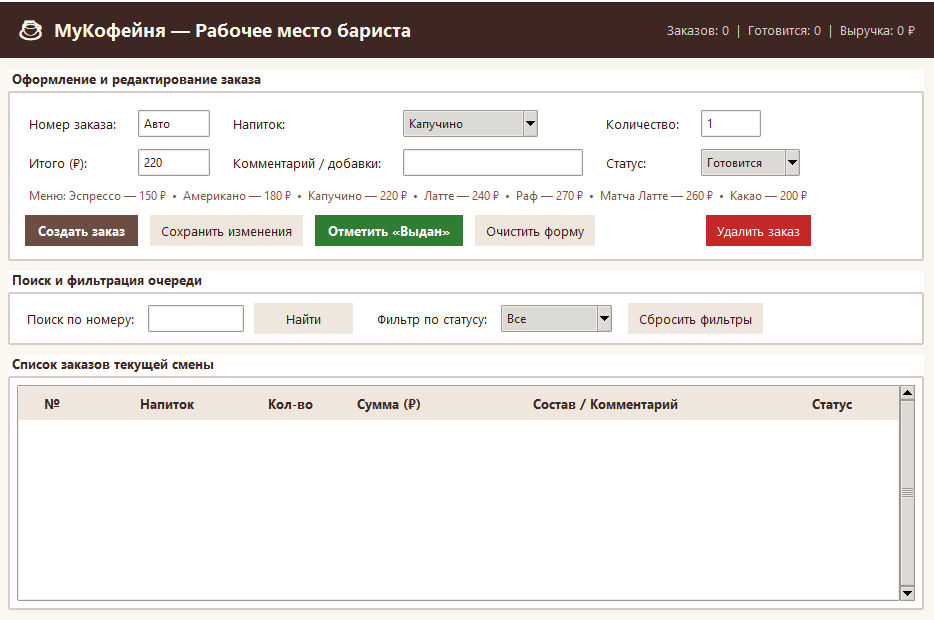

# MyКофейня — Система учёта заказов

Учебный проект настольного приложения на **Python + Tkinter** для автоматизации работы сотрудника кофейни (бариста/кассира).

- **Автор:** Смирнов Леонид Олегович, группа: 11 тес
- **Заказчик:** MyКофейня
- **Версия релиза:** v1.0

## Основные возможности

1. **Оформление заказа:** выбор напитка из меню, указание количества и комментария/добавок.
2. **Автоматический расчёт:** мгновенный подсчёт итоговой стоимости заказа при выборе напитка или изменении количества порций.
3. **Управление статусами:** отслеживание приготовления и перевод заказа из статуса `Готовится` в статус `Выдан`.
4. **Редактирование и удаление:** изменение состава заказа и безопасное удаление ошибочных позиций через диалог подтверждения.
5. **Поиск и фильтрация:** быстрый поиск заказа по его уникальному номеру и фильтрация списка по статусу.

## Установка и запуск

Для работы программы требуется только [Python 3.8+](https://www.python.org/downloads/) со стандартным модулем [Tkinter](https://docs.python.org/3/library/tkinter.html). Установка дополнительных пакетов не нужна.

1. Склонируйте репозиторий или распакуйте архив с проектом.
2. Откройте терминал в корневой папке проекта.
3. Запустите главный модуль [src/main.py](src/main.py) командой:

```bash
python src/main.py
```

## Структура проекта и документация

- **Исходный код приложения:** [src/main.py](src/main.py)
- **Журнал ручного тестирования (AT-1 — AT-7):** [tests/manual_checks.md](tests/manual_checks.md)
- **Проектная документация (`docs/`):**
  1. [Устав проекта](docs/01_Устав_проекта.md)
  2. [План проекта](docs/02_План_проекта.md)
  3. [Требования](docs/03_Требования.md)
  4. [Техническое задание](docs/04_Техническое_задание.md)
  5. [Протокол встречи № 1](docs/05_Протокол_встречи_1.md)
  6. [Отчёт о статусе спринта](docs/06_Отчет_о_статусе_спринта.md)
  7. [Документация продукта (руководство пользователя)](docs/07_Документация_продукта.md)

## Ограничения первой версии (v1.0)

- Все заказы хранятся в оперативной памяти во время работы программы и сбрасываются после закрытия окна.
- Подключение к базе данных и сохранение истории в файл запланированы для следующих версий (v2.0).


# Интерфейс приложения


